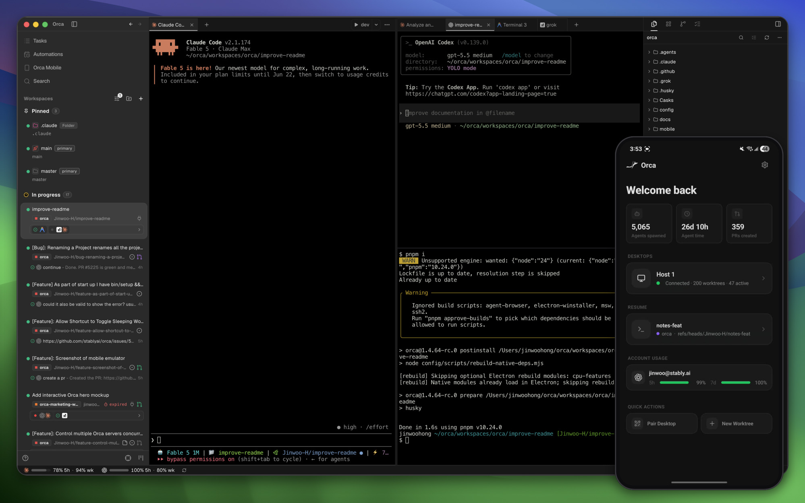

<div align="center">

# Agent Graph

A rework of Orca v1.4.206 — new brand, new interface, then graph-shaped agent workflows. Right now it is at step 1 of 5.

基于 Orca v1.4.206 的二开：换品牌、重构界面，再做带 Graph 的 Agent 工作流。目前在第 1 步（共 5 步）。

[](LICENSE)
[](package.json)
[](package.json)
[](https://github.com/songconmaisaix31-design/Agent-Graph/actions/workflows/pr.yml)



<sub>This is the upstream Orca screenshot shipped in the tree, not the reworked interface. No Agent Graph screenshot exists yet.<br/>这张图是树内自带的上游 Orca 截图，不是重构后的界面。目前没有 Agent Graph 的截图。</sub>

</div>

> **How to read this page / 怎么读这页**
> English first, then the same content in Chinese — not a summary, not a separate half. Tables keep both languages in one cell.
> 每段英文在前、同一内容的中文紧跟在后；不是摘要，也没有单独的"中文版"。表格把两种语言放进同一格。

---

## At a glance · 一眼看懂

| | |
|---|---|
| **Problem<br/>问题** | Forking a large Electron app drifts immediately: upstream updates, your data, your credentials and your dev profile all land in the same places.<br/>二开一个大型 Electron 应用会立刻漂移：上游更新、你的数据、你的凭据、你的开发 profile 全落在同一处。 |
| **Fix<br/>做法** | A pinned baseline (v1.4.206, one commit SHA) plus a dedicated dev entry that keeps state inside the worktree and refuses the unverified preview path.<br/>固定基线（v1.4.206，一个提交 SHA），加上专用开发入口：状态留在工作树内，明确拒绝未验证的 preview 路径。 |
| **Cost<br/>代价** | Node 24, pnpm 12.0.0, and Visual Studio C++ build tools — the native module build fails without them.<br/>Node 24、pnpm 12.0.0，以及 Visual Studio C++ 构建工具——没有它原生模块编译不过。 |
| **Not<br/>不是** | Not a working app yet, not a rebranded release, not a new execution kernel.<br/>还不是能用的应用，不是已换牌的发行版，也不是新的执行内核。 |

## What this is · 这是什么

A fork of Orca that keeps upstream's Electron + TypeScript + React stack and changes the product above it: brand, navigation, interface, then contest features. The baseline is pinned to **v1.4.206** at commit `c62eca3988ce4d7fce12fbfd20c0c47b39e9ecac`, imported as a fixed archive (29,094 entries) rather than merging `main`.

一个 Orca 分支，保留上游的 Electron + TypeScript + React 栈，改它上面的产品层：品牌、导航、界面，然后是比赛功能。基线固定在 **v1.4.206**、提交 `c62eca3988ce4d7fce12fbfd20c0c47b39e9ecac`，以固定归档导入（29,094 条目），不是合并 `main`。

| Branch · 分支 | Role · 作用 |
|---|---|
| `upstream-baseline/v1.4.206` | Read-only reference copy of the pinned baseline.<br/>固定基线的只读参考副本。 |
| `init/project-isolation` | The development branch — isolation hardening, dev entry, targeted tests.<br/>开发分支——隔离加固、开发入口、针对性测试。 |

This is not a rewrite of the execution kernel. Terminal, editor, diff and preview stay upstream components; the rework is expected to reach them through a new interface instead of replacing them.

这不是重写执行内核。终端、编辑器、Diff 与预览仍是上游组件；重构后的界面要能走到它们，而不是把它们替换掉。

## The plan · 五步

| Step · 步骤 | What it means · 做什么 | State · 状态 |
|---|---|---|
| 1. Clean base<br/>干净基座 | Separate directory, isolation of app identity / data / instances / CLI / update channel, first isolated launch.<br/>独立目录，隔离应用标识、数据、实例、CLI 与更新来源，做首次隔离启动。 | In progress — static checks pass, first launch NOT_RUN.<br/>进行中——静态检查通过，首次启动未运行。 |
| 2. Replace the brand<br/>替换品牌 | Logo, icons, wordmark, name and promo entries across UI and packages; keep LICENSE and upstream credits.<br/>界面与安装包里的 Logo、图标、字标、名称与推广入口；保留 LICENSE 与上游署名。 | Not started.<br/>未开始。 |
| 3. Rebuild the interface<br/>重构界面 | Navigation, home, session panels, layout, settings, loading/empty/error states, at 1080p and 720p.<br/>导航、首页、会话面板、布局、设置、加载/空/错误状态，检查 1080p 与 720p。 | Not started.<br/>未开始。 |
| 4. Prove features survive<br/>证明功能保留 | Before/after results for project, worktree, agent lifecycle, terminal I/O, edit/save, git diff, preview.<br/>项目、worktree、Agent 生命周期、终端输入输出、编辑保存、git diff、预览的前后对照。 | Not started.<br/>未开始。 |
| 5. Contest loop<br/>比赛闭环 | Task/evidence, independent review, built-in graph, failure relay, controlled retrieval.<br/>真实任务与证据、独立复核、内置 Graph、失败接力、受控检索。 | Not started.<br/>未开始。 |

## Verified so far · 目前验证到什么程度

Everything below was run on 2026-09-21 and recorded in [STATUS.md](STATUS.md). The honest summary: static checks and unit tests pass; nothing has been launched.

下面这些都在 2026-09-21 跑过，记录在 [STATUS.md](STATUS.md)。诚实概括：静态检查与单元测试通过；应用从未启动。

| Check · 检查 | Result · 结果 |
|---|---|
| `pnpm install --frozen-lockfile` | **FAIL** — `native/windows-registry` needs `node-gyp`; no Visual Studio installation found.<br/>**失败**——`native/windows-registry` 需要 `node-gyp`；未找到 Visual Studio。 |
| Same install with `--ignore-scripts --offline` | PASS, 1,283 packages reused — restores static-check deps only; skipping scripts does not mean a working native runtime.<br/>通过，复用 1,283 个包——只恢复静态检查依赖；跳过脚本不代表原生运行环境可用。 |
| `node config/scripts/agent-graph-dev.mjs --check-isolation` | PASS — paths stay inside the dev worktree.<br/>通过——路径都在开发工作树内。 |
| `vitest run` over 8 isolation-related files | PASS, 86 tests.<br/>通过，86 项测试。 |
| `tsc --noEmit -p config/tsconfig.node.json` | PASS.<br/>通过。 |
| Install → launch → open a test repo → terminal/agent/worktree smoke → restart | **NOT_RUN** — blocked on the C++ build tools.<br/>**未运行**——卡在 C++ 构建工具。 |

## Quickstart · 快速开始

### Requirements · 环境要求

Node **24** and pnpm **12.0.0** (declared in `package.json`), plus Visual Studio C++ build tools for the native modules.

Node **24** 与 pnpm **12.0.0**（见 `package.json`），以及编译原生模块用的 Visual Studio C++ 构建工具。

### 1. Install dependencies · 安装依赖

```powershell
pnpm install --frozen-lockfile
```

On a machine without the C++ toolchain this fails at `native/windows-registry`. Adding `--ignore-scripts --offline` gets you static checks only — do not treat that as a working install.

在没有 C++ 工具链的机器上，这一步会在 `native/windows-registry` 失败。加 `--ignore-scripts --offline` 只能拿到静态检查能力——不要把那个当成本地能跑。

### 2. Check the dev isolation · 检查开发隔离

```powershell
node config/scripts/agent-graph-dev.mjs --check-isolation
```

### 3. Start the dev session · 启动开发会话

```powershell
pnpm dev              # dedicated entry · 专用入口
pnpm dev-stable-name  # stable app name for UI comparison · 稳定应用名，便于界面对照
```

`pnpm start` refuses the built preview on purpose: it has not been verified. The dev entry keeps state in `.agent-graph/dev/{home,user-data}` inside the worktree and clears inherited Orca routes, provider data roots and credential variables.

`pnpm start` 会明确拒绝未验证的 built preview。开发入口把状态放在工作树内的 `.agent-graph/dev/{home,user-data}`，并清理继承来的 Orca 路由、provider 数据根与凭据变量。

## Documentation · 文档

| Doc · 文档 | Read it when · 什么场景读它 |
|---|---|
| [AGENT_GRAPH.md](AGENT_GRAPH.md) | You need the development brief: baseline, steps, acceptance rules.<br/>需要开发主提示词：基线、步骤、验收规则。 |
| [STATUS.md](STATUS.md) | You need the exact evidence and the current blocker.<br/>需要确切证据与当前阻塞。 |
| [AGENTS.md](AGENTS.md) | You are editing code and need the repository rules.<br/>改代码时需要仓库规则。 |
| [.github/CONTRIBUTING.md](.github/CONTRIBUTING.md) | You want the local setup and PR checklist inherited from upstream.<br/>需要继承自上游的本地安装与 PR 检查项。 |
| [cloud/README.md](cloud/README.md) | You are working on the mobile pairing relay.<br/>要动手机配对中继。 |
| [docs/STYLEGUIDE.md](docs/STYLEGUIDE.md) | You are touching UI tokens and components.<br/>要改 UI token 与组件。 |

## Repository layout · 仓库结构

```text
Agent-Graph/
├── src/
│   ├── main/            # Electron main process
│   ├── renderer/        # React UI (to be reworked)
│   ├── cli/             # `orca` CLI
│   ├── shared/          # cross-process contracts
│   ├── relay/           # mobile pairing relay
│   └── mobile-web/      # companion web surface
├── cloud/               # relay deployment, separate pnpm workspace
├── config/scripts/      # agent-graph-dev.mjs and the check scripts
├── docs/                # assets, readme translations, reference, audits
├── tests/               # Playwright e2e specs
├── mobile/              # separate workspace for the companion app
├── native/              # native modules — needs a C++ toolchain
└── .github/workflows/   # 66 workflow files inherited from upstream
```

## Status · 状态

Version **1.4.206** is the baseline's version, not a shipped Agent Graph release. The development branch has one hardening commit on top of the imported baseline.

版本 **1.4.206** 是基线的版本，不是 Agent Graph 的发行版本。开发分支在导入的基线之上只有一个加固提交。

Known limits, stated rather than hidden:

- Full `pnpm install`, Electron launch, runtime isolation, opening a test repo, terminal/agent/worktree smoke, and quit/restart are all **NOT_RUN**, not "assumed working".
- The blocker is environmental and needs a system-level change: Visual Studio C++ build tools are not installed on the development machine.
- No screenshots exist, so no claim about interface quality is made here.
- The dev-profile isolation is not an OS filesystem sandbox; it is a separate profile plus entry guards.
- The 66 workflow files are inherited from upstream; this page does not claim they run green on this branch.

边界写出来而不是藏起来：

- 完整 `pnpm install`、Electron 启动、运行期隔离、打开测试仓库、终端/Agent/worktree 冒烟、退出与重启，全部是 **未运行**，而不是"默认可以"。
- 阻塞是环境性的，需要系统级改动：开发机没有安装 Visual Studio C++ 构建工具。
- 没有任何截图，所以这里不对界面质量作任何断言。
- 开发 profile 的隔离不是操作系统文件沙箱；它是独立 profile 加入口守卫。
- 66 个工作流文件继承自上游；这页不断言它们在本分支上是通过的。

## License · 许可

MIT © 2026 Lovecast Inc. — inherited from [Orca](https://github.com/stablyai/orca) together with upstream credits. See [LICENSE](LICENSE).

MIT © 2026 Lovecast Inc. —— 与上游署名一起继承自 [Orca](https://github.com/stablyai/orca)。见 [LICENSE](LICENSE)。
